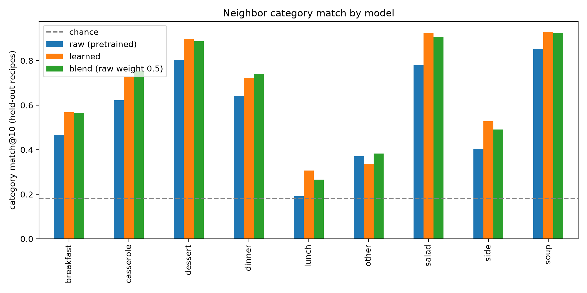
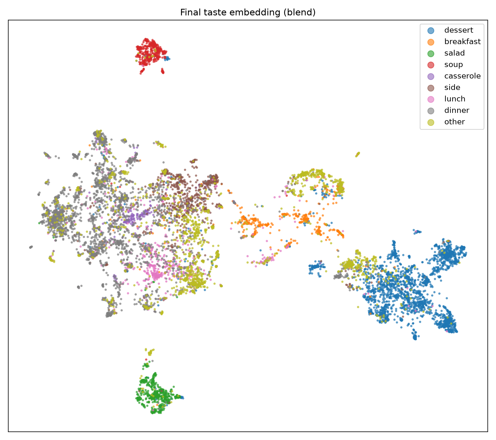

# 🍔 Taste Embedding Learning for Recipes

Learning vector representations ("taste embeddings") of recipes so that similar dishes sit close together and different dishes sit far apart. For example, a burger 🍔 and a chicken burger 🍗🍔 should be close, while a burger 🍔 and a dosa 🥞 should be far apart.

The project starts from a pretrained sentence-embedding model, measures how well it groups recipes, then trains a small projection head on top of it to improve retrieval 🎯, and finally blends the raw and learned embeddings to keep intuitive dish-level similarity ⚖️.

---

## 🏆 Key results

Evaluated on 2,000 held-out recipes, retrieving the 10 nearest neighbors from the 8,000 training recipes.

| Model | Category match@10 | Label overlap (Jaccard)@10 |
|---|---|---|
| Raw pretrained embedding | 0.599 | 0.359 |
| Learned embedding | 0.676 | 0.419 |
| **Blend (raw weight 0.5)** | **0.679** | 0.416 |
| Random (chance) | 0.181 | n/a |

- 📈 The learned and blended embeddings improve neighbor retrieval by about 8 points over the pretrained baseline.
- 🤝 The blend and the learned model are effectively tied on retrieval metrics. The blend is preferred because it also keeps intuitive dish-level similarity (see [Burger vs dosa](#-burger-vs-dosa-a-trade-off-and-its-fix)).

---

## 📊 Dataset

[Food.com Recipes with Search Terms and Tags](https://www.kaggle.com/datasets/shuyangli94/foodcom-recipes-with-search-terms-and-tags) (Kaggle).

- 🍳 494,963 recipes with 10 columns: `id`, `name`, `description`, `ingredients`, `ingredients_raw_str`, `serving_size`, `servings`, `steps`, `tags`, `search_terms`.
- 🎲 A random sample of **10,000 recipes** (seed 42) is used for all experiments.
- 🏷️ `search_terms` (for example `dessert`, `dinner`, `vegetarian`, `low-carb`) are used as labels. They are never part of the text that is embedded.
- 📥 The data is not included in this repository. Download it and place the CSV at `data/raw/recipes.csv`.

---

## 🧪 Method

### 1. 📝 Recipe text
Each recipe is converted to one string:

```text
Chicken burger. Ingredients: chicken patty, burger bun, lettuce, tomato, mayonnaise, onion.
```

Two variants were tested: **A** (name + ingredients) and **B** (A plus filtered tags). Generic tags such as `time-to-make`, `course`, and any tag about time or servings were removed. Version A is used for everything after the first comparison.

### 2. 🧊 Baseline embedding
`all-MiniLM-L6-v2` from sentence-transformers, giving 384-dimensional L2-normalized vectors. Similarity is cosine similarity.

### 3. 🎓 Learned taste embedding
A projection head on top of the frozen baseline vectors:

- **Architecture**: `Linear(384, 512) → ReLU → Dropout(0.1) → Linear(512, 128) → L2 normalize`
- **Labels**: the 51 `search_terms` that appear at least 50 times, as a multi-hot vector per recipe
- **Loss**: soft contrastive loss. For each batch, the target similarity between two recipes is the Jaccard overlap of their label sets, and the model is trained to match that distribution with a softmax over cosine similarities (temperature 0.1)
- **Training**: Adam (lr 1e-3, weight decay 1e-5), batch size 256, 30 epochs, 80/20 train/test split (seed 42)

### 4. 🔀 Blend
The raw and learned vectors are concatenated with weights `sqrt(α)` and `sqrt(1−α)`. The cosine similarity of the combined vector is then exactly `α · raw_similarity + (1−α) · learned_similarity`. The final model uses **α = 0.5**.

### 5. 📏 Evaluation
For each held-out recipe, the 10 nearest training recipes are retrieved and scored by:

- **Category match@10:** the fraction of neighbors sharing the recipe's main category (one of dessert, breakfast, salad, soup, casserole, side, lunch, dinner, other, assigned by priority order from `search_terms`)
- **Jaccard@10:** the average overlap of full `search_terms` label sets between a recipe and its neighbors
- **Chance:** the probability that two random recipes share a main category (0.181)

---

## 📈 Results

### 🏷️ Effect of adding tags to the text (no training)
Leave-one-out neighbors over all 10,000 recipes.

| Text | Category match@10 | Jaccard@10 |
|---|---|---|
| A: name + ingredients | 0.605 | 0.360 |
| B: A + tags | 0.610 | 0.377 |

Tags add very little, so ingredients carry most of the signal.

### 📊 Per-category category match@10 (held-out)

| Category | Raw | Learned | Blend (0.5) |
|---|---|---|---|
| 🥞 breakfast | 0.467 | 0.569 | 0.565 |
| 🥘 casserole | 0.622 | 0.728 | 0.755 |
| 🍰 dessert | 0.803 | 0.899 | 0.887 |
| 🍽️ dinner | 0.641 | 0.724 | 0.741 |
| 🥪 lunch | 0.191 | 0.307 | 0.266 |
| ❓ other | 0.371 | 0.336 | 0.383 |
| 🥗 salad | 0.779 | 0.924 | 0.907 |
| 🍟 side | 0.404 | 0.527 | 0.491 |
| 🥣 soup | 0.852 | 0.930 | 0.924 |



The learned embedding beats the baseline in every category except the catch-all "other", where it drops slightly (0.336 vs 0.371); the blend recovers it (0.383). Lunch remains weak, since "lunch" describes when a dish is eaten rather than what is in it.

### 🗺️ Embedding map



2D UMAP projection of the final blended embeddings. Soup 🥣 and salad 🥗 form tight, isolated clusters, desserts 🍰 form a large region, and breakfast 🥞 sits between the dessert and dinner regions. Dinner, lunch, side, and casserole overlap. This map includes recipes the projector was trained on, so the held-out table above is the real evidence. The map is for illustration only.

---

### 🍔 Burger vs dosa: a trade-off and its fix

Similarity of a burger recipe to hand-written recipes and dataset recipes (cosine):

| Pair | Raw | Learned | Blend (0.5) |
|---|---|---|---|
| burger vs chicken burger | 0.663 | 0.746 | 0.705 |
| burger vs pizza | 0.560 | 0.694 | 0.627 |
| burger vs dosa | 0.363 | **0.776** | 0.569 |
| burger vs cake | 0.273 | 0.496 | 0.384 |

The learned embedding improved retrieval, but it ranked dosa as the most similar to a burger, which is the wrong ordering. The training labels describe course and diet, not dish identity, so the model grouped short vegetarian snack-like recipes together. Blending with the raw embedding restores the intended ordering (chicken burger > pizza > dosa > cake).

Blend sweep (raw weight α):

| α (raw weight) | Category match@10 | Jaccard@10 | Intended ordering kept |
|---|---|---|---|
| 0.00 (learned only) | 0.676 | 0.419 | ❌ no |
| 0.25 | 0.683 | 0.425 | ❌ no |
| **0.50** | **0.679** | **0.416** | ✅ **yes** |
| 0.75 | 0.659 | 0.400 | ✅ yes |
| 1.00 (raw only) | 0.599 | 0.359 | ✅ yes |

---

### 🚀 Demo

```bash
python src/recommend.py "Dosa" "rice, urad dal, fenugreek seeds, salt, oil"
```

```text
0.739  Binch Akara (Bean Drops)
0.723  WW Rajasthani Dal Potli
0.719  Pumpkin Hummus
0.718  Pita Panini
0.715  Hummus Bi Tahina (Turkish Hummus)
```

Although the 10,000-recipe sample contains no dosa recipes, several of the nearest neighbors are legume-based dishes (beans, dal, chickpeas).

---

## ⚠️ Limitations

- Results come from a single run with one random seed on a 10,000-recipe sample. Small differences (for example 0.679 vs 0.676) are within noise.
- The labels mix course, diet, and other attributes, so "taste" here means "what kind of dish", not flavor profile.
- The blend weight was chosen using the same held-out split that reports the results, so the numbers are slightly optimistic.
- The dosa and chicken burger recipes are hand-written, and the sample appears to contain few Indian dishes, so they are out of distribution.
- The burger/dosa ordering check uses four hand-picked pairs. It is a qualitative sanity check, not a metric.
- The "other" category is a catch-all and not meaningful to interpret.

---

## 🛠️ How to run

1. Activate your virtual environment (if you set one up):
```bash
   source venv/bin/activate
```
2. Download the dataset from the Kaggle link above and save it as `data/raw/recipes.csv`.
3. Install dependencies:
```bash
   pip install -r requirements.txt
```
4. Run the pipeline from the project root:
```bash
   python src/prepare_data.py        # clean data, sample 10k recipes, build text versions
   python src/embed_recipes.py       # baseline embeddings for text A and B
   python src/compare_recipes.py     # burger / pizza / cake / dosa similarity (raw)
   python src/visualize.py           # UMAP map of raw embeddings
   python src/evaluate.py            # nearest-neighbor evaluation of raw embeddings
   python src/train_taste_model.py   # train the projection head
   python src/compare_learned.py     # raw vs learned on the demo pairs
   python src/blend_eval.py          # sweep the raw/learned blend weight
   python src/final_report.py        # final tables and figures
   python src/recommend.py "Recipe name" "ingredient 1, ingredient 2, ..."
```

Developed with Python 3.14 on macOS. Random seeds are fixed (42) for sampling, the train/test split, and training.

---

## 📁 Project structure

```text
taste-embedding-learning/
├── README.md
├── LICENSE
├── requirements.txt
├── .gitignore
├── data/
│   ├── raw/recipes.csv              (not in repo)
│   └── processed/                   (not in repo)
├── notebooks/
│   └── data_exploration.ipynb
├── src/
│   ├── prepare_data.py
│   ├── embed_recipes.py
│   ├── compare_recipes.py
│   ├── visualize.py
│   ├── evaluate.py
│   ├── projector.py
│   ├── train_taste_model.py
│   ├── compare_learned.py
│   ├── blend_eval.py
│   ├── final_report.py
│   └── recommend.py
└── results/
    ├── embedding_map.png
    ├── final_embedding_map.png
    ├── per_category_comparison.png
    ├── final_results.csv
    ├── per_category_results.csv
    ├── blend_sweep.csv
    ├── burger_dosa_comparison.csv
    ├── knn_evaluation.csv
    └── taste_projector.pt
```

---

## ✅ Acknowledgments

Recipe data: Food.com via the Kaggle dataset linked above. Embeddings: `all-MiniLM-L6-v2` (sentence-transformers).

---

## 📄 License

The code in this repository is released under the MIT License (see `LICENSE`).
The recipe data is not included and remains subject to its own terms on Kaggle.

---

## 👥 Authors

**Thrivikram Pudi** - [GitHub](https://github.com/SiddhuPudi)
**Abdul Sami** - [GitHub](https://github.com/abdulsami-S)